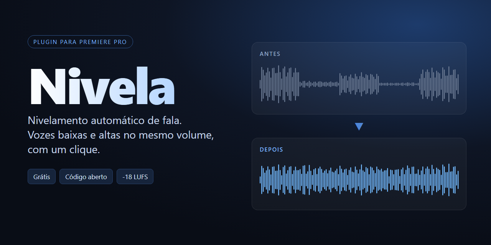
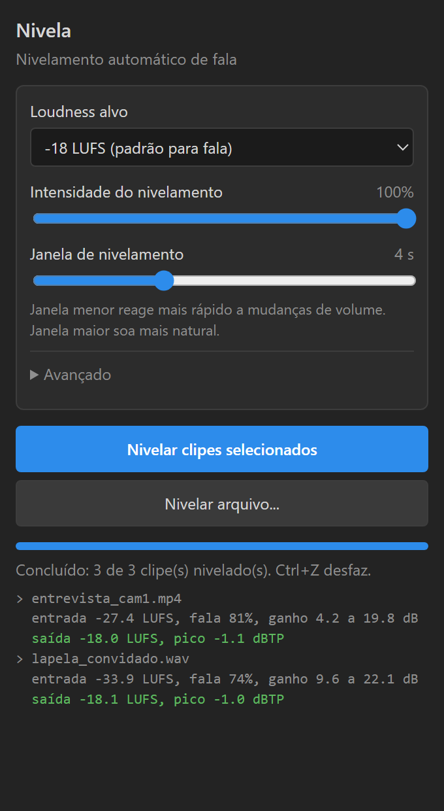

<p align="center">
  
</p>

<p align="center">
  <b>Vozes baixas e altas no mesmo volume, com um clique, direto na timeline do Premiere Pro.</b><br>
  Grátis e de código aberto.
</p>

<p align="center">
  <a href="https://github.com/jhesleyjx-cmd/nivela/releases/latest"><b>Baixar</b></a> ·
  <a href="#como-instalar">Instalar</a> ·
  <a href="#como-funciona">Como funciona</a> ·
  <a href="#english">English</a>
</p>

---

## O que é

Entrevista com um convidado que fala baixo, podcast com dois microfones desiguais, vídeo gravado com a câmera longe de quem fala. O **Nivela** analisa o áudio inteiro, encontra os trechos baixos e os altos e deixa tudo no mesmo nível de loudness. Não é um compressor comum: ele trabalha em janelas de alguns segundos, então a fala continua natural, sem aquele som "esmagado".

No final, o áudio sai normalizado no alvo escolhido (por exemplo -16 LUFS para podcast ou -14 para redes sociais) e com picos controlados.



### Recursos

- **Um clique na timeline**: selecione os clipes de áudio e clique em *Nivelar clipes selecionados*.
- **Não destrutivo**: o áudio nivelado entra numa trilha livre, alinhado amostra por amostra. O original fica só desativado, para você comparar. Ctrl+Z desfaz tudo.
- **Análise do arquivo inteiro** em duas passadas, como fazem os niveladores offline.
- **Alvos prontos**: -14, -16, -18, -19, -23 (EBU R128) e -24 LUFS (ATSC A/85).
- **Proteção de ruído**: não amplifica o chiado nas pausas entre as frases.
- **Limitador com pico real** (true peak, sobreamostragem 4x) e teto ajustável.
- **Cache**: o mesmo arquivo com os mesmos ajustes não é processado de novo.
- Aceita WAV, MP3, AAC, FLAC, MP4, MOV, MXF e o que mais o ffmpeg ler.
- Também funciona **fora do Premiere**, pela linha de comando.

<br clear="right">

## Como instalar

**Requisitos:** Windows, Premiere Pro 2022 ou mais recente (testado na 2026) e [ffmpeg](https://ffmpeg.org).

1. Instale o ffmpeg, se ainda não tiver:
   ```bash
   winget install Gyan.FFmpeg
   ```
2. Baixe o [último release](https://github.com/jhesleyjx-cmd/nivela/releases/latest) e extraia o zip (ou clone este repositório).
3. Clique com o botão direito em `instalar.ps1` e escolha **Executar com PowerShell**.
   O script copia o painel para `%APPDATA%\Adobe\CEP\extensions` e ativa o carregamento de extensões não assinadas (`PlayerDebugMode`).
4. Reinicie o Premiere e abra **Janela > Extensões > Nivela**.

> O painel encontra o ffmpeg sozinho. Se não encontrar, informe o caminho do `ffmpeg.exe` em **Avançado**.

## Como usar

1. Selecione um ou mais clipes de áudio na timeline (pode selecionar o clipe de vídeo junto, o painel pega só o áudio).
2. Escolha o loudness alvo e clique em **Nivelar clipes selecionados**.
3. O arquivo nivelado é salvo em `<pasta do projeto>\Nivelados`, importado no bin "Nivelados" e colocado na timeline sobre o original.

| Ajuste | O que faz |
|---|---|
| Loudness alvo | Nível final do áudio, em LUFS |
| Intensidade | 0% só normaliza; 100% nivela trecho a trecho por completo |
| Janela | Menor reage mais rápido; maior soa mais natural (padrão 4 s) |
| Reforço / Atenuação máxima | Limita quanto um trecho pode subir ou descer |
| Teto de pico | Pico máximo da saída, em dBTP |
| Compressão leve | Suaviza picos de fala que sobram depois do nivelamento |
| Não amplificar ruído | Segura o ganho nas pausas |

## Como funciona

Todo o processamento fica em [`levelcore.js`](com.jhesley.nivela/js/levelcore.js), sem dependências além do ffmpeg (que só decodifica e grava os arquivos).

```
arquivo ──ffmpeg──▶ análise ──▶ curva de ganho ──▶ render ──▶ medição ──▶ WAV 24 bits
```

1. **Análise.** O áudio é decodificado em blocos (sem carregar o arquivo inteiro na memória) e passa pela ponderação K da norma ITU-R BS.1770, a mesma usada para medir LUFS. A energia é guardada a cada 100 ms.
2. **Fala x pausa.** Calcula a loudness de curto prazo (janelas de 400 ms), estima o piso de ruído e separa o que é fala do que é silêncio.
3. **Curva de ganho.** Faz uma média móvel gaussiana da loudness, só sobre os trechos de fala, e calcula o ganho que leva cada região ao alvo, dentro dos limites de reforço e atenuação.
4. **Proteção de ruído.** Nas pausas, o ganho é limitado para o ruído de fundo ficar bem abaixo da voz.
5. **Normalização.** Prevê o LUFS integrado (com o gating da BS.1770) e ajusta a curva para cair no alvo.
6. **Render.** Aplica a curva, o compressor leve opcional e um limitador com look-ahead de 5 ms. O detector de pico estima os picos entre amostras com interpolação 4x.
7. **Medição e ajuste fino.** Mede o resultado e, se o compressor e o limitador tiraram loudness, corrige numa passada final.

A saída tem a mesma taxa de amostragem, os mesmos canais e o mesmo comprimento do original, alinhada amostra por amostra. Por isso pode ser colocada direto sobre o clipe.

### Linha de comando

```bash
node cli.js entrevista.mp4 entrevista_nivelada.wav --target -16 --window 3
```

Opções: `--target`, `--strength` (0 a 1), `--window`, `--maxBoost`, `--maxCut`, `--ceiling`, `--no-compressor`, `--no-noise`.

## Estrutura

```
com.jhesley.nivela/      extensão CEP
  CSXS/manifest.xml
  index.html, css/       interface do painel
  js/main.js             lógica do painel (Node habilitado)
  js/levelcore.js        motor de nivelamento
  host/host.jsx          ExtendScript: seleção, importação e timeline
cli.js                   uso pela linha de comando
instalar.ps1             instalador
```

## Limitações

- Só Windows por enquanto (o instalador e a busca do ffmpeg são para Windows; o motor em si é multiplataforma).
- Clipes com velocidade alterada, sequências aninhadas e multicam são ignorados.
- Usa a primeira faixa de áudio de cada arquivo.

Contribuições são bem-vindas: abra uma issue ou um pull request.

## Aviso

O Nivela é um projeto independente, escrito do zero. Ele foi inspirado no conceito de niveladores automáticos de fala como o The Levelator, mas não contém nenhum código deles e não é afiliado a eles nem à Adobe. Premiere Pro é marca da Adobe Inc.

Licença [MIT](LICENSE).

---

## English

**Nivela** is a free, open-source Premiere Pro panel that automatically levels speech: quiet and loud voices end up at the same loudness, in one click, right on the timeline.

- Two-pass analysis of the whole file using ITU-R BS.1770 K-weighting.
- Speech/pause detection, Gaussian loudness smoothing over a few seconds (not a regular compressor), noise protection in pauses.
- Normalization to a LUFS target (-14 to -24), optional gentle compressor, look-ahead true-peak limiter.
- Non-destructive: the leveled 24-bit WAV is placed on a free track, sample-aligned with the original, which is only disabled.

**Install (Windows):** install ffmpeg (`winget install Gyan.FFmpeg`), download the [latest release](https://github.com/jhesleyjx-cmd/nivela/releases/latest), run `instalar.ps1`, restart Premiere and open **Window > Extensions > Nivela**. The UI is in Portuguese.

**CLI:** `node cli.js input.mp4 output.wav --target -16`

Independent clean-room project, not affiliated with The Levelator or Adobe. MIT license.
